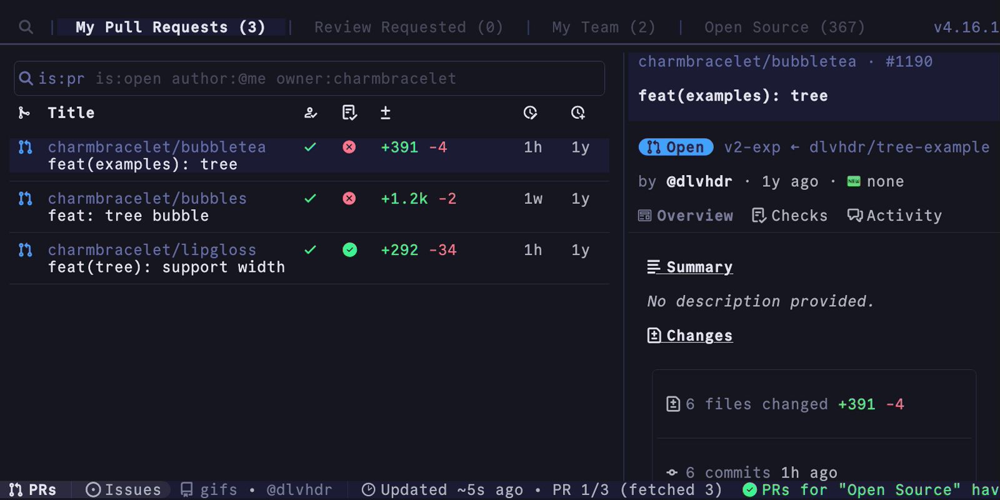

<br />
<p align="center">
  <a  class="underline: none;" href="https://github.com/hemanshulabs/gh-forge">
    <picture>
      <source media="(prefers-color-scheme: dark)" srcset="./docs/public/logo.png">
      
    </picture>
  </a>
</p>

<p align="center">
    <a href="https://github.com/hemanshulabs/gh-forge" target="_blank"><b>forge</b></a>
</p>
<p align="center">
  A rich terminal UI for GitHub that doesn't break your flow.
  <br />
  <br />
  <a href="https://github.com/hemanshulabs/gh-forge/releases"></a>
  <a href="https://github.com/sponsors/hemanshulabs"></a>
  <a href="https://www.jetify.com/docs/devbox" alt="Built with Devbox"></a>
</p>

<br />



## 📦 Installation

Requires the [GitHub CLI](https://cli.github.com/) and a [Nerd Font](https://www.nerdfonts.com/) for icons.

### As a `gh` extension (recommended)

```bash
gh extension install hemanshulabs/gh-forge
```

### Prebuilt binary

Download the binary for your platform from the [latest release](https://github.com/hemanshulabs/gh-forge/releases) and add it to your `PATH`.

### From source

```bash
git clone https://github.com/hemanshulabs/gh-forge
cd gh-forge
go build -o forge .
```

## ❤️ Sponsoring

If you enjoy `FORGE` and want to help, consider supporting the project with a
donation at the [sponsors page](https://github.com/sponsors/hemanshulabs).

<p align="center">
  <a href="https://github.com/sponsors/hemanshulabs">
    
  </a>
</p>

Thank you to all past and existing sponsors! 🙏🏽

<!-- sponsors:begin -->
<!-- this list is auto-generated by https://github.com/goreleaser/sponsors -->
<!-- sponsors:end -->

## 🌟 Features

- User-defined, per-repo, PRs & issues sections
- Overridable vim-style keyboard hotkeys
- Custom actions to perform your specific workflow needs
- Everything you can do on GitHub - diff, comment, checkout, push, update etc.
- Control every setting with a YAML config file

If you like quickly navigating with your keyboard, seeing the PRs and issues you need and you <strong>love the terminal</strong> - <code>FORGE</code> is for you! 🫵🏽

## 📃 Docs

`FORGE` documentation is available at [https://github.com/hemanshulabs/gh-forge/tree/main/docs](https://github.com/hemanshulabs/gh-forge/tree/main/docs).

## 🙏 Contributing

See the contribution guide at [CONTRIBUTING.md](./CONTRIBUTING.md).

## 🛞 Under the hood

`FORGE` uses:

- [bubbletea](https://github.com/charmbracelet/bubbletea) for the TUI
- [lipgloss](https://github.com/charmbracelet/lipgloss) for the styling
- [glamour](https://github.com/charmbracelet/glamour) for rendering markdown
- [vhs](https://github.com/charmbracelet/vhs) for generating the GIF
- [cobra](https://github.com/spf13/cobra) for the CLI
- [gh](https://github.com/cli/cli) for the GitHub functionality
- [delta](https://github.com/dandavison/delta) for viewing PR diffs

## Authors

hemanshulabs ([@hemanshulabs](https://github.com/hemanshulabs)) and the [community](https://github.com/hemanshulabs/gh-forge/graphs/contributors).
